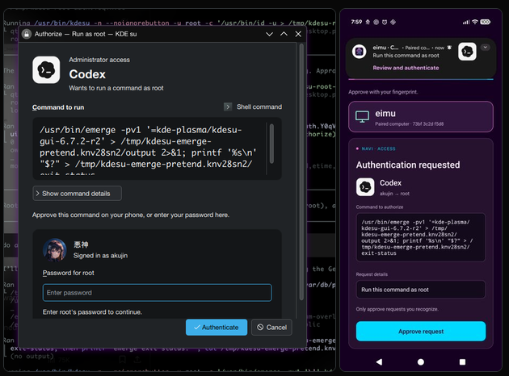

# kdesu Android biometric authentication

Approve a Linux **kdesu** root command on your Android phone. The phone shows the
requested command and requires a fresh strong biometric before signing it with
an Android Keystore key. A protected desktop helper verifies that signature and
executes the approved command.

Use your everyday phone, or turn a rear-sensor phone into a desk fingerprint
reader. With multiple enrolled phones, approve on whichever one is within reach.



*Desktop command review (left) and the corresponding phone approval screen (right).*

The standalone **Navi Authenticator** app can receive requests directly over local
Wi-Fi. That transport needs no KDE Connect, ADB, desktop notification daemon,
cloud account or Internet push service during normal authentication. kdesu itself
remains a graphical KDE program; the separate verification CLI can run headless.

**Experimental security software.** Real phone approval and root execution have
been demonstrated, but this is not a production login authenticator or a complete
security audit. Read [SECURITY.md](SECURITY.md) before installing the setuid helper.
Requester branding is currently caller-supplied, and update-signing custody is
part of the security boundary.

## What is included

| Component | Version / purpose |
| --- | --- |
| Android application | 0.8.3, API 28+, desk reader mode, non-debuggable release |
| Host CLI and native/Python authority | 0.7.2 with concurrent enrolled-phone requests |
| KDE patch and Gentoo packages | kdesu-gui 6.7.2-r3 against kde-cli-tools 6.7.2 |
| Direct Wi-Fi transport | Pinned TLS 1.3; restricted TLS 1.2 on Android 9; TCP 39841 |
| Optional KDE Connect transport | File sharing on Android 10+, or paired-device IP lookup for direct Wi-Fi |
| Android CI | Builds debug and release modes with a disposable signing key |

The verified phones are a **Pixel 9 Pro** running Android 16 and a **Nexus 6P**
running an Android 9 ROM. Android 9/API 28 is the minimum; the Nexus's older stock
firmware is unsupported. Installation and ADB enrollment currently accept Pixel
and Nexus 6P devices. Other phone models are unverified. The desktop baseline is
Gentoo with the patched KDE versions above; see the full
[prerequisites](docs/INSTALL.md#supported-baseline).

The new dedicated KDE Connect plugin was a separate unfinished experiment. It is
not needed for this release and is not included as a working feature. Bluetooth
delivery, PAM, sudo, login, screen unlock and general PolicyKit integration are
not implemented. Installing this does not reroute those authentication systems.

## Desk reader mode and multiple phones

After enrollment and network setup, enable **Desk reader mode** in the Android
app and leave Navi open and unlocked. The mode keeps the screen awake while Navi
is visible. A verified authentication request from a paired computer automatically
opens the biometric prompt, so a face-down Nexus 6P can work through its rear
fingerprint sensor alone.

Each approval still requires a fresh biometric. Each request opens automatically
only once; canceling it does not start a prompt loop. Pairing and network setup
retain their manual approval steps. The setting is opt-in and persists across app
restarts. Locking or leaving Navi suspends automatic prompting; turning the mode
off restores manual prompting and normal screen timeout.

The desktop attempts every enabled authenticator in its protected enrollment
registry concurrently. The first verified approval wins; other requests are
withdrawn, and an offline or declining phone does not block another phone. The
desktop must still commit the selected approval before the command runs once.
Password selection or cancellation before commit withdraws phone execution.
Adding a device to KDE Connect alone does not enroll it for biometric authorization.
See [installation](docs/INSTALL.md#6-configure-the-protected-enrollment) for
`--add-phone` and per-phone revocation.

## Start here

1. [Build, enroll and install](docs/INSTALL.md): prerequisites, initial ADB trust
   bootstrap, release update, and desktop deployment.
2. [Keep the phone available](docs/BACKGROUND.md): ongoing notification,
   background permissions, restart behavior and recovery.
3. [Architecture and protocol](docs/ARCHITECTURE.md): keys, exact request binding,
   ready/commit execution and revocation.
4. [Security findings](SECURITY.md) and [audit record](docs/SECURITY_AUDIT.md).
5. [Troubleshooting](docs/TROUBLESHOOTING.md) and
   [verified behavior](docs/VERIFICATION.md).
6. [Development and CI](CONTRIBUTING.md), including the existing KDE test suites.

After enrollment, a terminal can trigger a fresh approval:

```sh
python3 host.py authenticate --endpoint PHONE_IP:39841 \
  --application Terminal --operation 'Verify phone approval'

# Or resolve the phone's current LAN address through KDE Connect:
python3 host.py authenticate --kdeconnect-device PAIRED_DEVICE_ID \
  --application Terminal --operation 'Verify phone approval'
```

Choose the enrolled phone with `--phone-key-id PHONE_KEY_SHA256` if the host state
contains multiple phones. This CLI check verifies one phone; concurrent requests
are handled by the installed kdesu authority.

The CLI prints `AUTHENTICATED` only after verifying the fresh phone signature.
It does **not** execute an elevated command. After installing and configuring
the desktop integration, use:

```sh
kdesu -n --noignorebutton -c '/usr/bin/id -u > /run/navi-auth/example.uid'
```

Review the exact command on the phone and approve. The result should contain `0`.
kdesu status 0 confirms command **launch**, not the child's eventual exit status.
The install guide explains independent result verification and password fallback.

## Verified behavior

The September 21, 2026 deployment delivered two successive kdesu requests to both
enrolled phones. The Nexus approved each command, the child ran as UID 0, and the
competing Pixel request was canceled. The second run used desk-reader mode and
opened the biometric prompt automatically. The setting also survived app restart.
The existing KDE suites and Android build/signature checks passed for that update.
See [the verification record](docs/VERIFICATION.md) for evidence and remaining
coverage gaps, including physical reboot and deep-Doze delivery.

## Build and signing

The verified offline Android build uses SDK platform/build-tools 34, JDK 17+,
plain Java and Android framework APIs. There are no third-party Android runtime
libraries. Gradle/Android Studio metadata is also included,
but `build.sh` is the verified route and no Gradle wrapper is bundled.

New enrollment currently requires an explicitly debuggable build and authorized
ADB. Then install a release build **in place with the same app signing key**.
Do not uninstall or clear storage to update an enrolled phone. Each builder owns
their signing identity; this repository contains no private signing key or pairing
state. CI artifacts use a new temporary key per run and are disposable build
checks, not updates for an existing installation.

## License

Original code: [MIT](LICENSE). KDE/Gentoo code and the bundled requester icon retain
their existing licenses; see [third-party notices](THIRD_PARTY_NOTICES.md).
